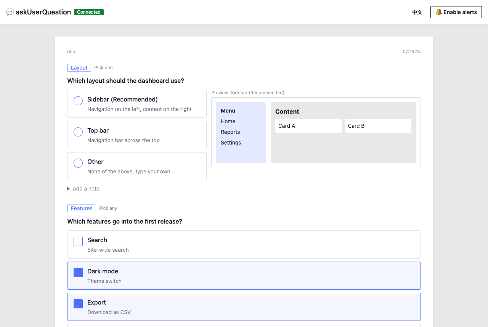

# askUserQuestion Web

English | [繁體中文](README.zh-TW.md)

Answer Claude Code's questions in your browser instead of the terminal. When Claude Code needs you to choose something, the question opens as a web page with clickable options, visual previews, and a box for your own answer. Your answer goes straight back to Claude Code.

If you switch to the Claude Code mobile app, questions automatically go back to the normal terminal style, so you never miss one.



## What you get

- Questions and options as cards: pick one or several, type your own answer under "Other", or add a note
- Side-by-side previews: compare layouts, components, or colors as real rendered HTML before choosing
- A sound and a desktop notification when a new question arrives
- The page opens by itself when Claude Code has a question, and closes itself 5 seconds after you answer
- English and Traditional Chinese interface

## Install from GitHub

Requires Node.js 20+, git, bash (macOS or WSL on Windows), and Claude Code. No dependencies, no `npm install` needed.

### Let Claude Code install it

Paste this into Claude Code:

```text
Install the askUserQuestion Web skill by following the README at https://github.com/idben/askUserQuestionWeb
```

### Install manually

```bash
git clone https://github.com/idben/askUserQuestionWeb.git
cd askUserQuestionWeb
scripts/install-skill.sh
```

- Installs to `~/.claude/skills/askuserquestionweb`
- Update: run `git pull` in the askUserQuestionWeb folder, then run `scripts/install-skill.sh` again
- Uninstall: `rm -rf ~/.claude/skills/askuserquestionweb`
- Start a new Claude Code session after installing so the skill is loaded

## Use in Claude Code

In your project, type:

```text
/askuserquestionweb
```

or just ask in plain words: "Start askUserQuestion Web".

- Claude Code starts a small local server in the background and opens the answer page in your browser
- Click "🔔 Enable alerts" the first time to allow desktop notifications; the browser remembers it. A sound also plays for new questions once you've clicked anywhere on the page
- From then on, whenever Claude Code would ask you something, the question shows up on the page
- Say "stop askUserQuestion Web" when you're done; Claude Code goes back to asking in the terminal
- Answers are stored in the project's `.auq/` folder; adding it to `.gitignore` is recommended (Claude Code offers to do this)
- Add `--port 5700` to choose a port (the default is 5700; the next free port is used if it's taken)

## On the answer page

| Action | How |
|------|------|
| Choose | Click an option. "Pick one" questions take a single choice; "Pick any" questions take several |
| Your own answer | Choose "Other" and type in the box that appears |
| Add a note | Open "Add a note" under a question |
| Preview | Hover over an option to see its preview on the right (below the options on narrow screens) |
| Submit | Click "Submit" or press `Ctrl / ⌘ + Enter` |
| Skip | Click "Skip" to decline the questions; Claude Code continues without your answer |
| Switch language | The "中文" / "EN" button at the top right |

- The interface follows your browser language; once you switch, your choice is remembered
- The page closes itself 5 seconds after you answer or skip, and reopens automatically for the next question

## When you're on your phone

The answer page only runs on your computer, so it can't be opened from your phone. Instead, Claude Code checks where you are before each question:

- You sent your latest message from the Claude Code mobile app → the question is asked the normal way, in the app
- You used your computer's keyboard or mouse more recently → the question goes to the answer page

Keyboard and mouse activity can only be read on macOS. On other systems, Claude Code decides by where your latest message came from.

## Running in a sandbox

If Claude Code runs its commands in a sandbox, some steps may be blocked. askUserQuestion Web handles them like this:

- **File watching is blocked**: the server notices and checks for new questions every second instead. Nothing to do on your side
- **The browser can't be opened automatically**: open `http://127.0.0.1:5700/` yourself (Claude Code shows the address)
- **The server can't run in the background at all**: start it yourself in another terminal, from your project folder, then tell Claude Code it's running:

  ```bash
  node ~/.claude/skills/askuserquestionweb/server.js --log .auq/server.log
  ```

To let everything run inside the sandbox instead, add these to the `sandbox` section of your `settings.json`:

```json
"sandbox": {
  "enabled": true,
  "network": { "allowLocalBinding": true },
  "allowAppleEvents": true,
  "excludedCommands": ["node *askuserquestionweb/server.js*"]
}
```

- `allowLocalBinding`: lets the server listen on a local port on macOS. It has no effect on Linux and WSL2, where each sandboxed command gets its own network, so the browser can't reach a server started inside the sandbox. On those systems, rely on `excludedCommands` or start the server yourself
- `allowAppleEvents`: lets Claude Code open the answer page in your browser. Sandboxed commands can then launch other apps, which weakens the isolation, so skip it if you'd rather open the page yourself
- `excludedCommands`: runs the server outside the sandbox. This is a convenience, not a security boundary; the command still goes through permission prompts

## Why some questions come back to the terminal

For actions that change something outside your computer, such as `git push`, writing to a database, or deleting remote data, Claude Code doesn't accept an answer from the web page as your approval, because answers from the page reach Claude Code as background notifications. In those cases Claude Code asks again in the terminal and mentions what you already chose on the page.

You can change this. If you pre-approve specific actions in your `CLAUDE.md` (for example: "Pushing to my own GitHub repos doesn't need confirmation"), Claude Code usually won't stop to ask about them at all. Everything else stays on the answer page.

## Security

- Runs only on your computer (`127.0.0.1`), never exposed to the network or other devices
- Rejects requests that use any other host name, which blocks DNS rebinding attacks from web pages
- Only the answer page itself can submit answers; other websites can't
- Other websites can't embed the answer page in an iframe
- Questions can only come from files Claude Code writes in your project, so a web page can't fake a question
- HTML previews run in an isolated frame that can't reach the answer page or your data
- No CDN and no CSS framework: the page loads only its own small files, so it works offline and can't be altered by a third-party server
- Answers stay in your project's `.auq/` folder

## License

[MIT](LICENSE)
