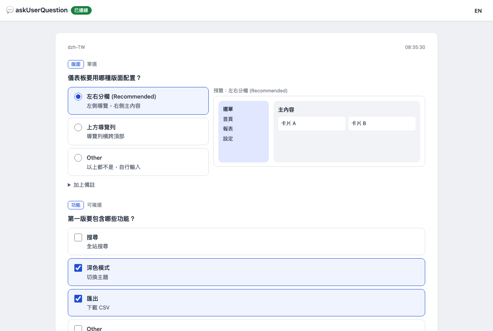

# askUserQuestion Web

[English](README.md) | 繁體中文

在瀏覽器回答 Claude Code 的提問，不用在終端機裡選。Claude Code 需要你做決定時，題目會出現在網頁上：選項可以直接點、能看視覺預覽，也能自己填答案。送出後答案會直接回到 Claude Code。

改用 Claude Code 手機 app 時，提問會自動改回原本終端機的方式，不會漏掉任何一題。



## 功能

- 題目與選項以卡片呈現：可單選或複選，在「Other」自填答案，或加上備註
- 左右分欄預覽：選擇前先比較版面、元件或配色的實際 HTML 畫面
- 新題目到達時有提示音與桌面通知
- Claude Code 要提問時自動打開頁面，作答完 5 秒後自動關閉
- 中文、英文介面

## 從 GitHub 安裝

需要 Node.js 20 以上、git、bash（macOS，或 Windows 的 WSL）與 Claude Code。沒有任何套件相依，不需要 `npm install`。

### 讓 Claude Code 幫你裝

把這段貼給 Claude Code：

```text
依照 https://github.com/idben/askUserQuestionWeb 的 README 安裝 askUserQuestion Web skill
```

### 自己安裝

```bash
git clone https://github.com/idben/askUserQuestionWeb.git
cd askUserQuestionWeb
scripts/install-skill.sh
```

- 安裝位置：`~/.claude/skills/askuserquestionweb`
- 更新：在 askUserQuestionWeb 資料夾執行 `git pull`，再執行一次 `scripts/install-skill.sh`
- 解除安裝：`rm -rf ~/.claude/skills/askuserquestionweb`
- 安裝後請開新的 Claude Code session，skill 才會載入

## 在 Claude Code 中使用

在你的專案中輸入：

```text
/askuserquestionweb
```

或直接說「啟動 askUserQuestion 網頁版」。

- Claude Code 會在背景啟動一個本機小伺服器，並在瀏覽器打開作答頁面
- 第一次使用時按「🔔 啟用通知」允許桌面通知，瀏覽器會記住；點過頁面任一處之後，新題目也會有提示音
- 之後 Claude Code 每次要問你問題，題目都會出現在頁面上
- 用完說「結束 askUserQuestion 網頁版」，Claude Code 就會改回在終端機提問
- 答案存在專案的 `.auq/` 資料夾，建議加進 `.gitignore`（Claude Code 會詢問是否幫你加）
- 加上 `--port 5700` 可指定 port（預設 5700，被占用時自動改用下一個可用的 port）

## 作答頁面操作

| 動作 | 方式 |
|------|------|
| 選擇 | 點選項。「單選」只能選一個，「可複選」可以選多個 |
| 自填答案 | 選「Other」，在出現的輸入框填寫 |
| 加上備註 | 展開題目下方的「加上備註」 |
| 預覽 | 滑鼠移到選項上，右側顯示該選項的預覽（窄螢幕顯示在選項下方） |
| 送出 | 按「送出」或 `Ctrl / ⌘ + Enter` |
| 略過 | 按「略過」不回答，Claude Code 會在沒有答案的情況下繼續 |
| 切換語言 | 右上角的「EN」/「中文」按鈕 |

- 介面語言預設跟隨瀏覽器，切換後會記住你的選擇
- 作答或略過後 5 秒，頁面會自動關閉；下一題來時會自動重新打開

## 在手機上時

作答頁面只在你的電腦上執行，手機打不開。因此 Claude Code 每次提問前會先判斷你在哪裡：

- 你最近一則訊息是從 Claude Code 手機 app 送出 → 用原本的方式在 app 裡提問
- 你最近操作過電腦的鍵盤或滑鼠 → 題目送到作答頁面

只有 macOS 能讀取鍵盤滑鼠的使用狀態；其他系統只依你最近一則訊息從哪裡送出來判斷。

## 為什麼有些確認會回到終端機

會改動電腦以外東西的動作，例如 `git push`、寫入資料庫、刪除遠端資料，Claude Code 不會把網頁上的回答當作你的同意，因為網頁答案是以背景通知的方式回到 Claude Code。這類情況會改在終端機再確認一次，並帶出你在網頁上已經做的選擇。

這可以調整：在你的 `CLAUDE.md` 事先授權特定動作（例如：「推送到我自己的 GitHub repo 不需要確認」），Claude Code 通常就不會再停下來問。其他題目照常在作答頁面回答。

## 安全

- 只在你的電腦上執行（`127.0.0.1`），不會對網路或其他裝置開放
- 拒絕使用其他主機名稱的請求，防止網頁利用 DNS rebinding 攻擊
- 只有作答頁面本身能送出答案，其他網站無法送出
- 題目只能來自 Claude Code 寫在專案裡的檔案，網頁無法偽造題目
- HTML 預覽在隔離的框架中執行，無法存取作答頁面或你的資料
- 不使用 CDN 也不使用 CSS 框架：頁面只載入專案自己的小檔案，離線也能用，也不會被第三方伺服器竄改
- 答案只存在專案的 `.auq/` 資料夾

## 授權

[MIT](LICENSE)
